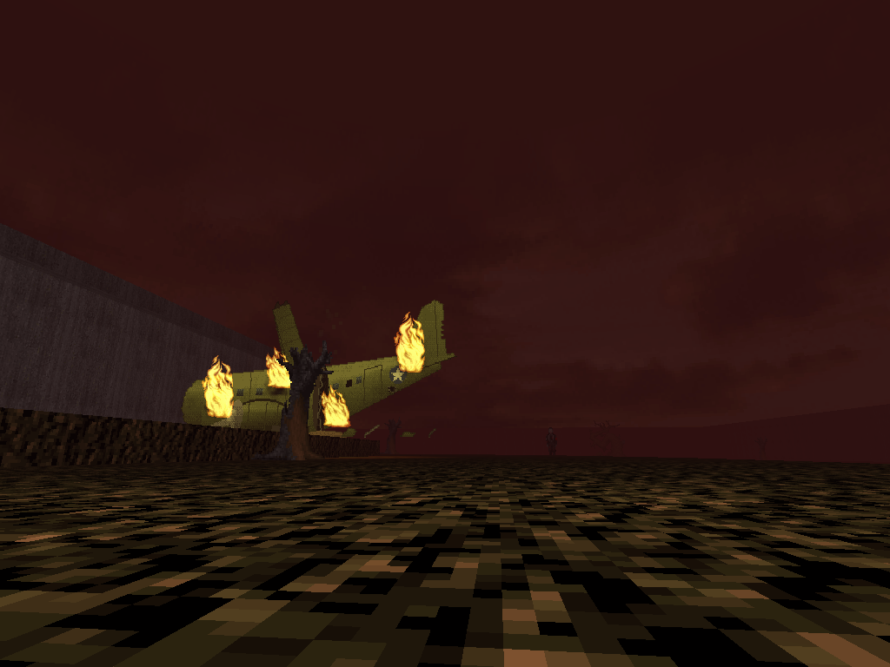
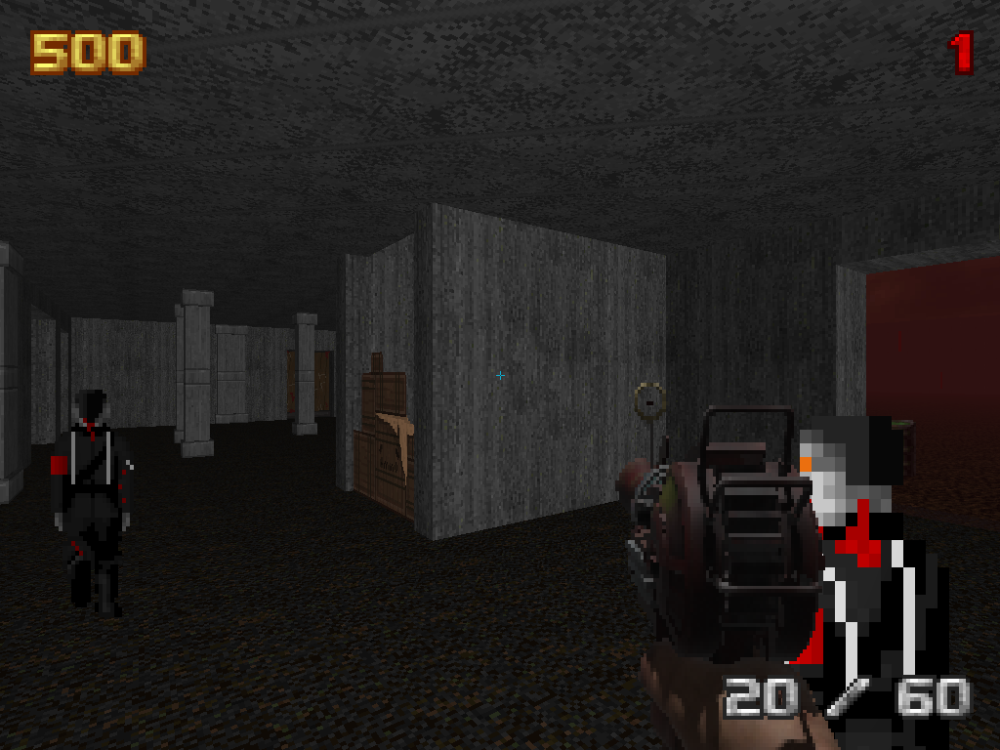
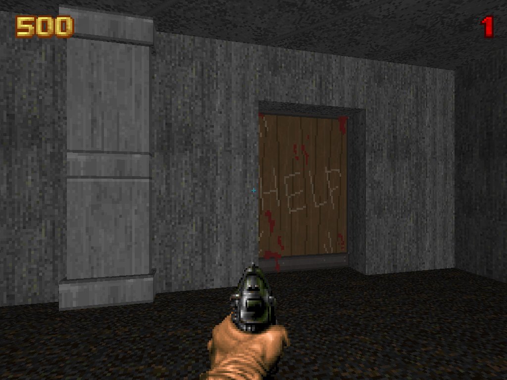
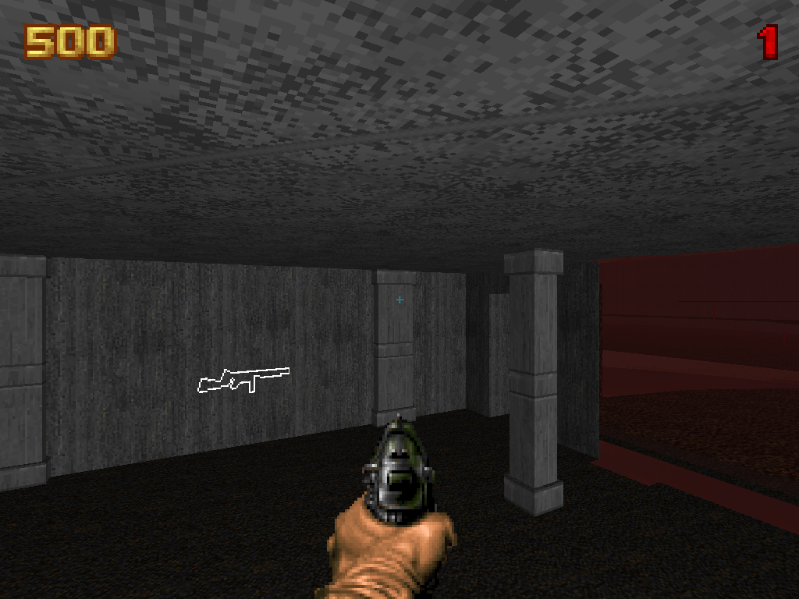

# Nacht des Schreckens

> **AI notice:** this project is developed with the help of AI. The history up to July 2025 was written by hand; since October 2026, much of the code and documentation is written with [Claude](https://claude.ai) (Anthropic), working under my direction and review. Commits that Claude helped write carry a `Co-Authored-By: Claude` trailer, so you can see which ones in the history.

A remake of Nacht der Untoten, the first zombies map of 'Call of Duty: World at War', as a Doom 2 mod for the [UZDoom](https://github.com/UZDoom/UZDoom) source port. It brings the features and spirit of the classic 'Call of Duty Zombies' maps to Doom 2: hold out against endless rounds of zombies, earn points, buy weapons off the walls, open doors, gamble on the mystery box, drink perks and revive your friends.

The zombies mode itself is [Horde Hammer](https://github.com/error-error-fruit-user/horde-hammer), a library this map is built on. Many of the map's assets are taken from or based on 'World at War' (see [Credits](#credits)).









## Installation & Configuration

Nacht des Schreckens runs on [UZDoom](https://github.com/UZDoom/UZDoom) 5 or newer, and needs [Horde Hammer](https://github.com/error-error-fruit-user/horde-hammer), loaded before it:

```
uzdoom -iwad doom2.wad -file horde-hammer.pk3 nacht.pk3
```

`python3 publish.py` here (and in Horde Hammer) makes the pk3s in `published/`. Without Horde Hammer, UZDoom stops at startup with "Unknown class HH_...".

For the IWAD, use 'doom2.wad' from a legal copy of [Doom + Doom II](https://store.steampowered.com/app/2280/DOOM__DOOM_II/), or 'freedoom2.wad' from the [Freedoom project](https://freedoom.github.io/download.html).

The easiest way to play is [tdl](https://github.com/error-error-fruit-user/tdl), a launcher for UZDoom: make a profile with `horde-hammer.pk3` then `nacht.pk3`, and give it this repository's `config.ini` as its ini to get nacht's keyboard controls. The controller layout below is Horde Hammer's: it offers it the first time you press a button on a controller.

To avoid weapon sprite cropping, set the aspect ratio to 4:3 in-game (the weapon sprites will be widened later for wider ratios).

To play against Doom's own monsters instead of the zombies, set 'Zombies' to 'Rogues gallery' in the full options menu. Horde Hammer's own options (toggled zoom, where each part of the HUD goes) are under 'Horde Hammer Options'.

## Default Controls

|Action|Keyboard|Xbox Controller|
|:---:|:---:|:---:|
|Movement|WASD Keys|Left Stick|
|Fire|Left Click|Right Trigger|
|Use|E Key|A Button|
|Reload|R Key|X Button|
|Zoom|Right Click|Left Trigger|
|Kick|F Key|Right Stick Click|
|Swap Weapon|Mouse Wheel|Y Button|
|Quick Swap|1-9 Keys|D-Pad (Clockwise starting from left)|
|Drop Weapon|C Key x2|Right Bumper x2|
|Repulse/Skip Intro|Q Key|Left Bumper|

## Multiplayer

Host or join with tdl: the host serves the profile's files, and joiners download whatever they're missing.

## Credits

### Crew

- **Alexis Dutcher**: Lead Artist
- **Tyler Wojciechowski**: Lead Developer

### Base games

- **id Software's [Doom + Doom II](https://store.steampowered.com/app/2280/DOOM__DOOM_II/)**: the IWAD the mod runs on. Nacht ships no textures of its own, so every wall, floor and ceiling on the map is a Doom 2 texture (`GRAY5`, `ROCK3`, `RROCK03`, `BROWNHUG`, `FLAT5_4`, `FLAT1`, ...), and so is the sky. The fires on the crashed plane loop the Arch-vile's flame frames (`FIRE`). The Doom marine player class keeps Doom's weapons, and the 'Rogues gallery' option sends Doom's monsters instead of the zombies.
- **[Freedoom](https://freedoom.github.io/)**: the free IWAD the mod also runs on, in place of Doom 2.
- **Treyarch's [Call of Duty: World at War](https://store.steampowered.com/app/10090/Call_of_Duty_World_at_War/)**: the map remade, and the source of most of nacht's art:
    - The weapons' first-person and pickup sprites, converted from World at War to Doom's sprite style: the M1911, .357 Magnum, M1 Garand, M1 Carbine, Kar98k, Thompson, PPSh-41, Type 100, double-barreled shotgun and Ray Gun.
    - The perks' bottles and the four drinking animations, cropped frame by frame from the game.
    - Every weapon's firing and reload sounds, taken straight from the game (many still carry its own names, like `wpn_ppsh_st_f` and `gr_357_open`).
    - The perk drinking sounds: swallowing and the bottle breaking.

### Other mods and libraries

- **ZDL's [COD Zombies](https://www.moddb.com/mods/call-of-duty-nazi-zombies)** (the ZDL Edition of Call of Duty: Zombies for Doom 2), where nacht started out:
    - The zombie: every frame of its walking, attacking and dying sprites (`NAZO`).
    - The Insta-Kill, Max Ammo and Nuke power-up sprites, and the Ray Gun's projectile and its explosion.
    - The Insta-Kill and Double Points HUD icons.
    - The rest of the sounds, which were most likely pulled from World at War in the first place:
        - The zombie's moans, sprinting, injured, headshot and attack sounds, and its fall when it dies.
        - The announcer and jingles: the game start, round change, siren, purchase and mystery box sounds, the Nuke, Double Points, Insta-Kill, Max Ammo and Fire Sale pickups, the power-up grab, and the power-ups fading.
        - The intro music and the game over music.
- **Boondorl's [Weather library](https://github.com/Boondorl/Weather)**: the blood rain, vendored unchanged under its own license (`LICENSE-weather`).
- **[Horde Hammer](https://github.com/error-error-fruit-user/horde-hammer)**: the zombies mode itself (rounds, points, doors, the box, perks, drops, last stand, the kick, the HUD), which nacht's own code became.

### Made for nacht

- The mystery box, the doors and the Juggernog, Quick Revive, Speed Cola and Double Tap machines, drawn by Alexis Dutcher.
- The Fire Sale and perk HUD icons, drawn by Tyler Wojciechowski with ZDL's power-up icons as a template.
- The crashed plane, drawn by `tools/plane.py`.
- The chalk wall buys: the Kar98k's, M1 Carbine's and Thompson's by hand, the rest traced from the weapons' pickup sprites by `tools/chalk.py`.

### Used in earlier versions

- **dodopod's [ZScript Weapons Library](https://forum.zdoom.org/viewtopic.php?t=61172)**: the first weapons, since rewritten.
- **[NTM's Quick Kick](https://github.com/LocalInsomniac/NTMAi/blob/master/zscript/weapons/kick.txt)** ([forum thread](https://forum.zdoom.org/viewtopic.php?p=1181624#p1181624)): the old kick, replaced by Horde Hammer's own.

## License

This is open source to anyone, as long as they follow the licenses of the parts that carry their own:

- `LICENSE-weather` (Boondorl's Weather library)

Please email me if you feel that any other licenses should apply: tylerwojo81@gmail.com
